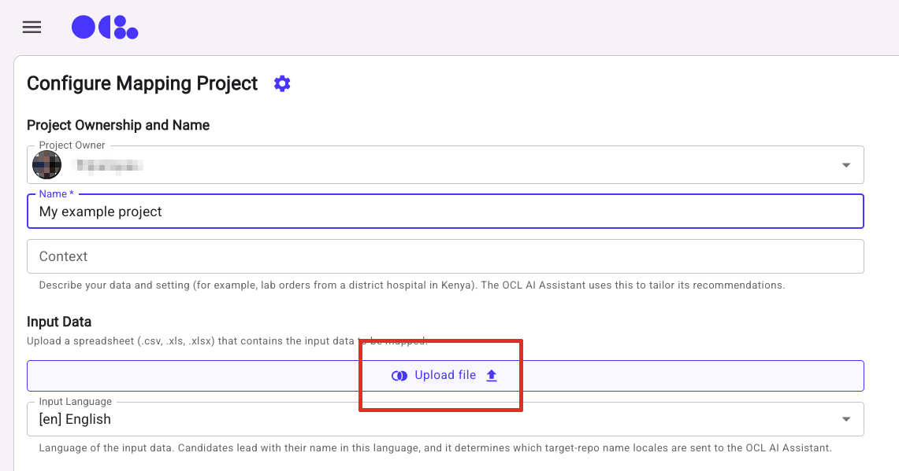

# Mapper Sample Files

Use these CSVs to try OCL Mapper with a recommended target repository. **Guided demos** use clear terms to make matching easier to follow. **Real-world samples** use less uniform wording and are intended for a more challenging trial; results may need more review. For every sample, you can use its domain reference terminology or **CIEL:CIEL** as the target. Comparing both illustrates how an interface terminology can support mapping across clinical domains. Repository links open the corresponding source entries in OCL Online; sign-in or access may be required.

For project creation and field configuration, start with the [Quick Start](overview.html#quick-start) in the Mapper Overview.

## Guided demos

The four guided demo files use `Code,Name`; their `Code` values are CIEL concept IDs. If you choose CIEL as the target, map `Code` to **ID**; for other targets, leave it unmapped. The original lab sample also has a `Specimen` column, and its `Code` values are local codes rather than target IDs. These examples help users inspect candidate results, but they do not guarantee an exact or equivalent match for every row.

| Sample | Suggested target repositories (`ORG:SOURCE`) | Download |
|---|---|---|
| Diagnoses | [WHO:ICD-10-WHO](https://app.openconceptlab.org/#/orgs/WHO/sources/ICD-10-WHO) or [CIEL:CIEL](https://app.openconceptlab.org/#/orgs/CIEL/sources/CIEL) | [CSV](samples/mapper_sample_github_diagnoses.csv) |
| Procedures | [SNOMED-International:SNOMED-GPS](https://app.openconceptlab.org/#/orgs/SNOMED-International/sources/SNOMED-GPS/) or [CIEL:CIEL](https://app.openconceptlab.org/#/orgs/CIEL/sources/CIEL) | [CSV](samples/mapper_sample_github_procedures.csv) |
| Lab tests and imaging | [Regenstrief:LOINC](https://app.openconceptlab.org/#/orgs/Regenstrief/sources/LOINC) or [CIEL:CIEL](https://app.openconceptlab.org/#/orgs/CIEL/sources/CIEL) | [CSV](samples/mapper_sample_github_lab_imaging.csv) |
| Mixed domains (general purpose) | [CIEL:CIEL](https://app.openconceptlab.org/#/orgs/CIEL/sources/CIEL) | [CSV](samples/mapper_sample_github_general_ciel.csv) |
| Lab tests (original sample) | [Regenstrief:LOINC](https://app.openconceptlab.org/#/orgs/Regenstrief/sources/LOINC) or [CIEL:CIEL](https://app.openconceptlab.org/#/orgs/CIEL/sources/CIEL) | [CSV](samples/mapper_sample_lab_tests.csv) |

## Real-world samples

These real-world samples use informal, abbreviated or less predictable terms to show a harder matching task. Their term columns are named `Name`; since they contain no specimen data, the CSVs use `Code,Name`. The `Code` values are row numbers, not target terminology codes.

| Sample | Suggested target repositories (`ORG:SOURCE`) | Download |
|---|---|---|
| Diagnoses | [WHO:ICD-10-WHO](https://app.openconceptlab.org/#/orgs/WHO/sources/ICD-10-WHO) or [CIEL:CIEL](https://app.openconceptlab.org/#/orgs/CIEL/sources/CIEL) | [CSV](samples/mapper_sample_realistic_diagnoses.csv) |
| Procedures and imaging | [SNOMED-International:SNOMED-GPS](https://app.openconceptlab.org/#/orgs/SNOMED-International/sources/SNOMED-GPS/) or [CIEL:CIEL](https://app.openconceptlab.org/#/orgs/CIEL/sources/CIEL) | [CSV](samples/mapper_sample_realistic_procedures_imaging.csv) |
| Medications | [CIEL:CIEL](https://app.openconceptlab.org/#/orgs/CIEL/sources/CIEL) | [CSV](samples/mapper_sample_realistic_medications.csv) |

The medication target is a broad starting point, not a claim that every drug name has an exact CIEL match. Compare candidates with the intended clinical meaning before confirming a mapping. For all samples, check that the suggested source and version are available in your Mapper instance; repository access and content can vary.
